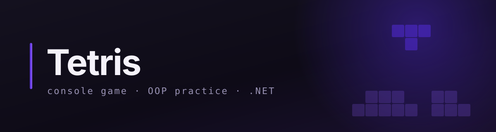

<div align="center">




</div>

---

# tetris — a console Tetris in C#

A Tetris that runs in the terminal: a grid drawn with characters, pieces that fall, rotate
and lock, lines that clear. No game engine and no graphics library — just `Console` and
plain classes.

---

## 🎯 Learning goal

This is practice for my university OOP course, built alongside
[csharp-learning](https://github.com/artemlehotskyi/csharp-learning). The labs there are
small, isolated tasks; here the same ideas have to hold together in one program that keeps
growing.

I write all of the game code by hand. The order of the roadmap follows the course: a class
hierarchy only appears once the course has covered inheritance, and only where a piece
actually behaves differently — not as decoration.

---

## 🗺 Roadmap

| № | Step | What it is about | Status |
|---|---|---|---|
| 1 | Board | grid, bounds, cell state, `Draw` | 🔨 in progress |
| 2 | Tetromino | one class, shape passed as data through the constructor; `RotateLeft` / `RotateRight` / `Move` | ⏳ planned |
| 3 | Collision | `CanPlace` check, move-then-revert | ⏳ planned |
| 4 | Game loop | non-blocking input (`Console.KeyAvailable` / `ReadKey`), timing, rendering | ⏳ planned |
| 5 | Polymorphism | subclasses only where behaviour differs: the O-piece doesn't rotate, the I-piece needs wall kicks | 🔒 after the course covers inheritance |

---

## ▶️ How to run

```bash
git clone https://github.com/artemlehotskyi/tetris.git && cd tetris
dotnet run --project Tetris
```

Requires the .NET 10 SDK. Run it in a real terminal rather than the IDE's output pane once
the game loop lands — non-blocking key input needs an interactive console.

---

## 🛠 Stack

| | |
|---|---|
| Runtime | .NET 10.0 |
| IDE | JetBrains Rider |
| OS | macOS |
